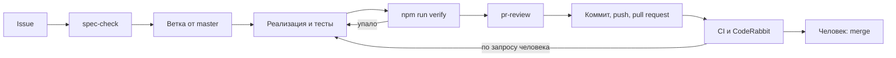

# Доработка по issue и проверка

Issue ведёт разработчик вместе с одним агентом. Агент может быть любым. Пошаговые инструкции для него — `AGENTS.md`. Здесь — кто за что отвечает и чем подтверждается результат.

## Роли

| Кто | Что делает |
|---|---|
| Разработчик | Пишет или уточняет issue, ставит задачу агенту, отвечает на его вопросы, решает по ревью, делает merge |
| Агент | Ветка, код, тесты, локальные проверки, коммит, push, pull request. Дальше — только по запросу |
| CI | Повторяет `npm run typecheck` и `npm test` на чистой машине |
| CodeRabbit | Ревью diff после push. Что делать с замечаниями, решает разработчик |

Коммиты попадают в `master` через pull request.

## Issue

Шаблон «Доработка или ошибка»: область, кто сталкивается, «что сейчас», «что должно быть», 2–5 критериев «Дано / Когда / Тогда». Хотя бы один критерий — негативный: ошибочный ввод, отказ или запрещённое состояние. Для поведения тренажёра каждый критерий становится тестом в `test/`. Для области docs issue называет проверку командой или чтением, и в pull request пишут вывод.

Области: session, dossier, model, access, docs. От области зависит, какой ADR читать перед правкой.

Агент останавливается и спрашивает, только если критериев нет, они допускают два прочтения, задача меняет правило предметной области или изменение хранилища стирает проекты, досье, сессии или ключи. Для docs отсутствие теста в `test/` само по себе не остановка.

## Проверки

Результат подтверждается командами, а не отчётом агента.

| Проверка | Команда | Локально | CI |
|---|---|---|---|
| Всё перед коммитом | `npm run verify` | да | по шагам ниже |
| Один файл по ходу работы | `node --test test/<файл>.test.ts` | да | нет |
| Типы | `npm run typecheck` | внутри verify | да |
| Тесты | `npm test` | внутри verify | да |

`npm test` — это `node --test`. CI гоняет тот же набор на Ubuntu.

## Pull request и ревью

- Описание — по `.github/pull_request_template.md`: `Closes #N`, что изменено, какой тест или проверка закрывает критерий, фактический вывод команд.
- В таблицу проверок писать вывод команд.
- После push CI и CodeRabbit отрабатывают сами. Замечание агент исправляет или отклоняет со ссылкой на ADR, глоссарий или правило, затем повторяет проверки.

## Merge и закрытие

1. Разработчик смотрит diff и зелёный CI и делает merge.
2. Issue закрывается через `Closes #N`.
3. Уроки: повторяемый сбой стека — `.cursor/rules/learned-cases.mdc`; продуктовое решение — `GLOSSARY.md` или ADR.
